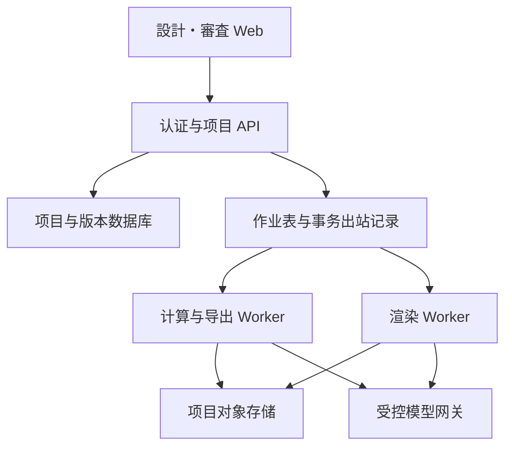

# Marq AI Design Engine 增量开发规格与 Codex 任务书

**2026-11-25｜内部实施稿 V2｜基线 Marq_MADE_Engineering_3_1_1.zip｜对应日文客户提案 V2**

## A. 给工程负责人的结论

第一笔开发预算应落在三件事上：认证现有排板规则、把“意图”变成有范围和证据的设计选择、把单栋实证生成的各项成果绑定到同一修订版。3.1.1已经有本地工作台、几何内核、导出、图片编辑请求与项目协作代码。直接新建Next.js＋PostgreSQL系统会重复开发并增加板缝回归风险。下文按现有入口给出改造方法；独立新机上的技术栈留到容量与部署评审决定。

**可交付的确定性**：同一批准输入、同一已发布规则包和同一已归档选解应重现相同工程几何；约定样例逐项核验，失败则阻止相关批准。立面美学、客户偏好、法规适用、摄影构图及供应商生成质量各有判断主体。合同把覆盖范围、测试数据、期望值和人工签认写清，不能把这些决定合并成一个“100%适合”布尔值。

### A1. 本次实际核查

- 基线包SHA-256为 `362e9b1e2f4cfd7ca9bd7a7f02eb19ac7a82cb1d68914010ef5ef5ccab9ecb51`。根目录为 `Marq-MADE/`。本次在隔离副本、Python 3.12.14下运行原包29项Python自动测试全部通过，另运行原包Node项目表单测试通过；现网Python 3.9.17、办公设备WebGL、客户CAD及付费模型调用尚待在相应环境验证。
- 独立从主册G18图像读取23个模块的板格中心，G20按原页分组重读329/265个数字；与包内默认 `engine/rules.json` 一致。Gemini的C4、C6与原图有差异；两条长串虽等长，从横贴第290位、竖贴第172位起出现差异（索引从1开始）。不能把Gemini的代码块覆盖默认规则。`word-comparison` 仅用于旧案对照。
- 实算一个54m×14.4m、横贴600mm立面。把一整张4.5m×0.6m的强调板设为开口，Slate Navy从129.60降为126.90㎡、银色648.00㎡不变，面板数288→287。两次均生成DXF/XLSX字节。这里只验证确定性内核和导出路径；未将该例认定为客户建筑或CAD验收。
- 阅读代码发现包内版本并非处处相同：交付包3.1.1，`layout.solve`写入的engineVersion是3.1.0。发布清单应分别记录应用版本、内核版本、规则内容哈希，保持历史快照可读。

### A2. Gemini方案逐项裁决

| Gemini中的主张 | 实际业务后果 | 采用办法 |
|---|---|---|
| 活的品牌资产、面向一线与稟议的双重价值 | 最有说服力的是重复设计判断可以留下来 | 保留。让品牌担当看见同一规则在不同仓型下的批准案例，让高层看实测变更成本 |
| 地域意象→密度场→图案→解释 | 可使新案有来源；把模型输出直接当逐格设计会使外形与语言脱节 | 保留密度场为目标。先给可拖动的意图几何，再求解，再按实际板件重写说明 |
| 横竖贴均允许自由优化番手 | G20横贴指定序列被改写后便无法称为标准案 | 横贴优化允许的设计选择；竖贴意图仅在别册适用范围内优化番手。超出范围另立实验版本 |
| 各模块色率取平均、贪心减号到达上限 | 异跨、异层、裁片、开口、压盖都会改变色面积；番手降低也不必然降低面积 | 逐物理面预计算裁后净面积；全部约束独立复算。不在冲突时偷偷放宽 |
| 两格最小留白、四格绝对禁ABAB、0.45层权重、1.5秒必出结果 | 客户给的是定性原则、示例或经验区间；时间上限不等于可行性保证 | 做可版本化策略参数；品牌方签认后才作为对应案件硬规则；无解与超时分开处理 |
| 零JSON的三栏CAD式工作台、可视化笔刷 | 专业人员可直接表达“改哪一面、哪个范围” | 保留三栏、选取和差异；普通用户只看有单位的参数和日文原因。显示已通过项数/需协商项数 |
| 航拍对齐＋系统提示词，20–40秒 | 概念正确；提示词不能锁定像素，时延包含队列与重试 | 复用同画幅底图/深度/保护蒙版与本地重合成；测试端点和数据授权，记录端到端P50/P95 |
| 现代前后端整套重建，ZDR请求头 | 当前包可离线演示，现网有旧版本约束；日本区域存储也不能证明外部推理仅在日本 | 渐进接入，先验实际合同、端点、地区及留存；未授权项目继续走离线通道 |
| 核对工时减少90%、CG成本减少40–50%、3–5案回本 | 缺少同任务对照、年案件量、外包和运维成本 | 做工时对照实验，输出客户参数化的投资回收表；招租转化作为长期业务观察项 |
| 施工级DXF、精确订货、全球复制、全社推广日期 | 多方审批与供应链、国家规范均有前置条件 | 初版交设计协调图与概算；生产/海外分别认证。时间和价格在样本与责任分工确定后报价 |

### A3. 真实工程的改造位置

| 已有文件或函数 | 已观察的能力 | 下一次改动 |
|---|---|---|
| `engine/layout.py: pattern, levels, calculate, calculate_groups, solve`、`modules.py`、`rules.json` | H/V/wave、银覆盖、分组计算、净面积、缓存、工程结果ID。wave最多试12个种子，按问题数择优 | 保留H/V历史路径。新意图候选使用显式模块选择或经认可的波形参数；引入单独解验证器，缓存与结果哈希加入新输入 |
| `engine/policy.py: normalize`、`geometry.py`、`signs.py`、`procurement.py: takeoff` | 图形处理、连接验证、标志、采购相关统计 | 集中判定哪些属硬约束/待协商。零分母单设状态；未配置景观上限、单价时不能给出“通过/零成本” |
| `server.py`、`engine/gateway.py: commercial` | 本地HTTP服务＋SQLite、分项目角色、修订、模型接入；文字结构已有narrative/mode/wave | 沿用 /api/made/v1/。把意图提案、求解、事实说明分三步；后端校验允许修改的字段。SSO和生产作业恢复是试点升级项 |
| `web/ui.js, view.js, facade-skin.js, rendering-fixes.js, project-forms.js` | 日文工作台、已有板缝显示及建筑表单 | 在现有视口叠加余白、峰位、固定区和差分，不另写整套3D；回归不同观察角度下的均匀目地 |
| `web/site-photo.js: controlsForEdit, finishEdit`、`engine/image_edit.py: edit_request` | 现有路径已传构图、背景、深度和mask，1536×1024请求适配；前端按裁框还原图像并重叠建筑和前景 | 加控制点残差、权利状态、镜头元数据与保护区验收。说明书“仅传环境底图”与实际请求有差异，应按实际四层更正授权提示 |
| `engine/formats.py: dxf, xlsx, glb`、`web/selftest.html`、`tests/` | 导出器、交互测试入口、已有工程夹具 | 扩展原导出加入意图证据与审批快照；在实际收图软件测量。严格兼容旧案；已有修订不能因默认解算器更新而重新着色 |

**坐标与单位有实际兼容风险**：原包面局部纵坐标从顶向下，世界坐标的竖向为Y。V2采用这一现状作为存储基准。若优化器采用从下到上的楼层编号，则 floorBottomIndex=F−1−rowTopIndex。若对外采用Z向上或立面CAD正向朝上，应在单一边界转换并测试往返；切忌把新公式直接套进原包的坐标数组。既有limit用0–100的百分数，求解器上限用p/q。API只在一处作转换，并保留缺失值与0的区别。

### A4. 可执行的第一项复验

在解压出的Marq-MADE根目录运行。以下脚本只在内存中构建示例；可作为正式测试夹具的独立预期值。

```bash
python3 -m unittest discover -s tests -v
node tests/project-forms.mjs
python3 - <<'PY'
from engine.layout import solve
from engine.geometry import rect
from engine.formats import dxf, xlsx

p = dict(name="立面検証", mode="H", rules="p18-baseline", stock="dry",
         pitch=600, floors=[7200, 7200],
         faces=[dict(id="E", spans=[9000] * 6, features=[])])
for opened, navy, panels in [(False, 129600000, 288), (True, 126900000, 287)]:
    if opened:
        p["faces"][0]["features"] = [dict(kind="opening", poly=rect(18000, 1800, 4500, 600))]
    result = solve(p)
    face = result["faces"][0]
    assert face["finishes"]["Silver"] == 648000000
    assert face["finishes"]["Slate Navy"] == navy and face["panels"] == panels
    assert dxf(p, result, "draft") and xlsx(p, result, "draft")
PY
```

**逐字回归指纹**：删去分组空白，仅对ASCII数字串做SHA-256。横贴为 `7aad473c28ef48dd89b8ac48090098873a68d7cbcd23c2063a53b67f4314051d`；竖贴为 `8d73887d152a19f29d89b7f8280c42816854c33ed3baacde0a8f632b6ca946ed`。位图用按类型、番手、位置的独立对照夹具核验，不能只比1的数量。

### A5. 意图求解的具体编码接口（新增）

在既有engine下增加小模块，保留原导入路径。输入使用模型无关的数据类。意图单位统一：面域u∈[0,1]自左至右，楼层k自底至顶。入口/标志锚点同时引用对应feature ID，校验该ID属于当前修订/面；模型不得发明锚点。优先复用现有feature类型。建议的受控字段如下。

| 字段/接口 | 合同 |
|---|---|
| IntentDraft | revisionId、faceId、observer、goal、approvedEditable、anchors、quietIntervals、peaks、layerBias、priority、evidenceRefs。每区间0≤start<end≤1，峰含center、width>0、strength∈[0,1]。限条数，拒绝越界/未知枚举，设计者可拖动后冻结 |
| build_target(intent, grid) | 将语义草案投影为目标强调占比。示例 D(k,u)=clip[b(k)＋Σ hᵢ exp(−(u−μᵢ)²/(2σᵢ²)),0,1]。安静区施加上界/惩罚；b、μ、σ、h均来自已确认参数。输入范围、浮点到定点的量化固定，避免模型生成大矩阵。视点与锚点未提供时先选预设 |
| evaluate_option(cell,n,geometry) | 返回裁后可见强调色面积a、选定分母贡献d、可用区间和规则命中。相同几何下d不依赖颜色。缓存键含局部几何哈希、候选编号、裁边和覆盖条件 |
| solve_intent(...) | H/V指定序列走已有内核，对允许的配置排序；wave对适用的模块优化。采用整数成本 C[c,n]=round(scale·w[c]·abs(a[c,n]−D[c]·d[c]))，Σ C[c,n]x[c,n]与重复/变更惩罚共同最小化。d=0时排除该项；保留番手轮廓作为低优先级判别。在小夹具穷举得到最优解作为独立oracle |
| validate_candidate(...) | 使用最终实体独立核对每面真实净面积、来源图样、冻结范围、跨层规则、上限、协商项。返回硬失败/待协商/建议。计算成功、品牌批准、供应商确认是不同状态 |
| explain_from_facts(...) | 输入已通过的板件事实、峰区/余白、同版视点和来源；输出日文说明与事实ID。影响区或版号变化即标旧，数字与部位不一致回到确定性说明模板 |

**为什么必须按面积计算**：假设两个裁后区域分别100㎡与25㎡，色率10%与50%。简单平均给出30%，实际是(10＋12.5)/125＝18%。若大区才是50%，实际则为42%。同一“平均30%”会把合格案退回，也会放行超限案。试验输入20%是项目假设，绝不能标为某自治体的法定值。保留视觉意图和特注采购限额各自的分母。

## 1. 从原型到组织试点的迭代边界

将A1测试清单作为本地演示的技术证据。面向客户展示时，旧功能按原包运行，意图密度场、供应商端点切换、独立控制点误差、可靠作业恢复均应按M3–M5的实际完成状态标识。开发提交应附一项用户能感知的变化、一份新旧版输出对照及回退操作。

## 2. 来源、判定权与待决项

以 G 表示主册物理页，以 V1–V3 表示别册物理页（印刷页31–33）。每条规则记录来源版、物理页、适用条件、校验级别、示例和审批人。主册同号页31–33是内装。PDF首页标示机密，限本项目获准人员使用；客户授权范围、外部AI处理、第三方制作应分别记录。

| 页 | 对工程的影响 |
|---|---|
| G1–4 | 机密、目录、一致性、共同语言、判断依据；案例允许按项目解释，同时平衡维护与成本。用作评审目标 |
| G5–10 | 企业宗旨、品牌命名/框形标志/用色、六类利益相关方；Marq Aura对应外装与室外，Marq Inspire对应使用者室内体验。形成意图词库、视点和审查标签 |
| G11–16 | 范围、外装概念及五项设计代码；按干仓/冷冻冷藏切换材料角色。Electric Blue在指定部位使用 |
| G17–20 | 标志、墙面组合、A/B/C、起点、扫描、端裁、循环。建立有来源的基准数据包 |
| G21–25 | 标志留白、雁行、缺口、窗、外露设备、坡道及站台。几何与饰面分层处理 |
| G26–28 | 横贴900mm、竖贴、CS/BOX及BOX形态为视觉参照，可用于比对；不据示意图反算未标注的工程尺寸 |
| G29 | 入口清晰、步车分流、绿化维护和可视性。先作为外观评审项，后续接入景观与动线图层 |
| G30–37 | 室内五原则和门厅、电梯厅、走廊、办公室、休息室/餐厅、卫生间六类空间。二期可记录入口与外部连贯性；各空间功能、运维、安全另行建模 |
| G38–40 | 材料候选库；无标志、横贴600mm A型的CAD参考覆盖至35跨×8模块高；PMV、ARES-Marq指南、Overview Deck、标志手册、初期设计代码须向客户确认最新版 |
| V1–V3 | 定余白、选/编图案、分层调号。V1的“p.〇”为空白引用，暂将G21列为相关规则，交策定者确认 |

**开工澄清登记表**：① G20竖贴与V的关系、适用项目及审批人；② 从右侧起排是否镜像模块内部板序（区分扫描方向与板内顺序，以图样和客户CAD验证）；③ 哪些梯级/过渡格允许用1、跨楼相等限制的适用范围；④ 特注限额按面、整栋还是采购批次，景观比率分母和扣除项；⑤ 标志手册、可融合两面及雁行比例界限；⑥ 已授权底图用途、外部推理许可、可测试资产。可以先做有依据的部分。未决项展示「要協議」并限制相关版的正式批准；不得以默认数值假装已获同意。

## 3. 确定性几何内核与认证图样

### 输入与板型

输入采用毫米，沿用3.1.1的世界Y向上、面域纵坐标自顶向下，优化器与CAD的坐标转换见A3。持久化面坐标变换、外侧法向与朝向；审批和导出保持毫米。每面带外轮廓、内孔、楼层标高、跨累计边界、贴向、働き幅、外部主视点标签及与邻面拓扑。PoC先做平面多边形墙及经人工标注的开口、雁行和坡切。未知曲面、斜扭墙或无法可靠导入的图形应显示需要人工建模的面。CAD参考底图先支持人工描边和已知边长标定，禁止猜测尺寸。

横贴h≤750取A，模块宽为**当前跨**的一半、高12h；h>750取B，高8h。跨宽不同即每跨单独分半。从墙顶向下排，模块行可跨楼层。竖贴C宽15w（w为单板实际働き幅），高为所在楼层实际层高。尺寸为正、跨长总和与面宽一致性、层标高单调、几何闭合须在求解前校验。主册没有给出可无限承载的建筑规模；上线时公布实测范围。

下表依据G18图块，以1为アクセント；A/B从上到下，C从立面图左到右。先固化为测试夹具，再由客户确认后发布正式规则包。切换配色时只改变材料角色。

| 番手 | A 12板 | B 8板 | C 15板 |
|---|---|---|---|
| 0 | 000000000000 | 00000000 | 000000000000000 |
| 1 | 000000010000 | 00000100 | 000010000000000 |
| 2 | 100000100000 | 10000000 | 001000001000000 |
| 3 | 000100010001 | 00100001 | 100001000100000 |
| 4 | 100100100100 | 10010010 | 010010100001000 |
| 5 | 000011011011 | 00101101 | 100101001000100 |
| 6 | 110110110000 | 11011000 | 101011011001010 |
| 7 | — | — | 011101110111011 |
| 8 | — | — | 111101111011110 |

**原提案校正**：C4按图为第2、5、7、12板；C6为第1、3、5、6、8、9、12、14板。B1/B2、A5/A6等编号可能有相同的色板数但位置不同，不能以编号除以最大编号代替色面积。验证方式为源图中心采色、独立人工逐格对照和客户认可样例三步。

### 指定数列与扫描

G20横贴数列329位，竖贴265位。以下文本作为受控输入，行空格仅为读图分组。以字符串存储保留前导零。对照人须独立查看原图、记录SHA-256和批准日期。草案不得直接升级为生产批准包。

```text
横
00003 45654 52321 00000 00234 56320
00000 03412 14300 03652 10000 01436
30000 03654 32100 01456 54523 43630
00000 00000 23456 32000 00002 34520
00345 45634 54321 00000 32543 63452
30000 01234 56321 23456 54300 00000
23432 00000 00000 03234 32343 23000
00345 43000 00123 65456 54300 00012
34563 21234 56543 00000 14563 23000
00003 65630 00000 00000 32100 00000
34545 63454 32100 00000 00001 2343
縦
00023 63200 04365 67400 02567 45323
21000 35400 01256 54323 21000 00232
36540 00345 65745 46300 00000 43678
54000 32674 00000 45353 00045 67654
00000 00000 03654 10000 01452 34100
00000 45676 52325 63100 01256 54323
21000 00345 63000 00125 63210 00000
02356 54367 65340 00002 36320 00436
56740 00000 02567 45323 21000
```

右侧标志从右上开始，否则左侧、中央、无标志及获准合面的情况均从左上开始。行末回到起点一侧下一行，延续序号而非换行归零或蛇形。令i为**展开的完整覆盖格**连续索引，取S[i mod len(S)]。先放整模块再按轮廓裁端，禁止拉伸最后一块。对齐开口、裁掉的部分保留逻辑格索引，不能因出现窗洞而压缩数列。复杂缺口的覆盖格定义用批准案例锁定。合面先建立共用展开坐标再反映射到各面，数量仍逐物理面统计。六跨无标志A型首行十二格应为000034565452，第二行首格为3。分页或缩放皆不影响结果。

### 特例处理的依赖顺序

| 环节 | 实施和检查 |
|---|---|
| 定拓扑 | 每面默认独立。品牌主角两侧联排需Marq协商；雁行处正对面连续投影，直交小面与指定切缺区用Silver；比例差异显著禁止直接套用，人工确认可见性和适用性（G17、22） |
| 定域与格线 | 租户标志横列先留出顶上一整模块Silver，数列从其下起算。纵列租户标志向下延伸，尺寸待协商。竖贴各层连续窗在窗带宽范围按窗顶对齐模块下端，分段设基准；异层窗带不齐、端点交错则显式判断（G21、23） |
| 生板及裁剪 | 在确定的格网展开番手，裁墙外边、窗孔；横贴/单层连窗、单窗直接开洞。横贴坡口阶梯、竖贴沿坡线斜切，下缘收口以单独构件标注。保留来源物理板ID与裁片ID（G19、23–24） |
| 覆盖饰面 | 角部品牌标志横贴4×1.5、竖贴2×1.5模块，两侧均处理；非角部以标志为中心，横贴6或竖贴3模块宽，高1.5模块，上方留一个M宽。将来开口用板与排烟窗按板定位，命中Accent则对应整板改Silver。标志留白跨非等宽模块及半层时按局部实际尺寸换算，若边界穿板须给出整板处理待审项（G21、23） |
| 独立构件 | 设备平台、外楼梯、雨水管、有压扇等按跨规整标注，位置由设计人员确认。坡道腰墙Dark Gray，中线Electric Blue占见付高度14–20%；车道檐下墙Medium Gray、柱F19-20B；泊位编号在规定位置用黑底白字，一层外墙覆盖于排板上。编号格式及开始号来自项目/标志手册（G23–25） |
| 最终校验 | 孔洞区域无饰面，独立构件与母墙避免重复计量。记录每次覆盖前后、来源及面积差。手工锁定与刚性规则冲突时保留旧版、新版提示具体板号；禁止覆盖后静默批准 |

## 4. 从意图到可求解的立面

### 职责和候选空间

多模态模型读取用户简短要求、获准的局部图、视点及受控词典，返回意图草案。内部结构包含目标面、观看者、目标区间、优先级、可变项、冻结项、选择依据、待确认事实。后端限定字段、枚举、坐标范围、数量、文本长度和引用；模型无法写规则库或批准例外。建筑师在立面画框、拖动余白或选择候选后确认。用户提及的ChatGPT 6.2 Astra、Gemini Carbon作为意图供应商候选，GPT-image2.5、Gemini NanoBanana Pro作为图像候选；这些名称不充当服务端模型ID。登记真实端点、地区、计费、数据条款、图像编辑和遮罩能力，通过合同及样本测试后启用。

横贴或竖贴指定数列模式：在已经获准且尚未冻结的离散变量中枚举（标志位置、合面选项、可用墙体/贴向组合），每个组合完整计算一次G20。只剩一套合法条件时输出一个基准方案和解释；不得为制造“三案”而移相、重排或调色。竖贴意图模式须有别册适用许可，允许选择余白、峰位、跨度、层级强度；同一项目可为不同面保存不同意图。

### 可实现的竖贴优化

1. 以面展开后的列j和楼层k定义模块。V1：0/1为余白，2以上为强调；按≤10跨1处、11–19跨2–3处、≥20跨3–4处建立**建议**区间。优先选择标志/入口附近，合并连续片区，避免等距碎片。最小可辨识宽度由视觉试验标定，不能当作客户既有数值。余白模板可按楼层变化。保留1作边界过渡，标志禁色覆盖优先。
2. V2：山並み234565432、双峰234323432、鞍型654323456、台地234555432、尾根234567。将样本按区间长度作分段线性插值取得目标番手，再量化。支持多个区段、非等宽峰和经批准的自定义意图。对25252525式交替做显式检测，对等距重复段作可视化提示。窗口长度/惩罚权重由品牌方校准。
3. V3：k自底向上，K>1时以k/(K−1)给出由弱到强的目标权重，单层跳过层间约束。优化以实际色板面积和编号轮廓共同衡量强弱。上下相等时“下层减1”仅为一种修正方式；重算后复检下下层、区域边界及面积。连续纯银留白/强制银区可以上下相同。V3示例含低层1过渡，优先保留客户例图，严格模式对适用的上下强调模块禁止同号。
4. 变量x[c,n]表示格c使用番手n，取0或1，Σn x[c,n]=1。每个已定几何/余白布局预先裁出候选板片，应用银覆盖后得到a[c,n]（可计入的强调色面积）。面f的A_f=Σa[c,n]x[c,n]；分母D_f由已确认的景观口径得到。每面约束 q A_f ≤ p D_f 对应上限p/q；D_f=0时显示不适用。特注材料限额另按项目约定的可见面积或订货量计算，二者不得混用。上限未填显示「未設定」，禁止宣称合规。
5. 先满足几何、锁定、颜色与已确认限制。再最小化 Σ w₁|n_c−t_c| + w₂·余白偏离 + w₃·重复罚分 + w₄·与保留方案差异；t来自用户认可的意图曲线。可分次锁定首要目标再优化次要目标。保留排序权重、变更来源和各项得分。多案需要在获准区域有可见差异，例如不同峰区或不同留白中心，用模块差异数下限去重；无差异则减少案数。
6. 固定布局用整数CP-SAT或有界枚举；面积用定点整数，斜切保留有理面积或保守向上/下界做约束，末端用原几何复验。每次求解固定输入、规则包、引擎版本、随机种子和执行设置；归档实际选解以供重现。超时有可行解则经独立检查后标注，超时无解标为「計算未完了」，已证明不可行标为「条件が両立しません」。用约束分组重算定位冲突，给出可编辑项。禁止自动放宽限额。[OR-Tools求解状态与整数约束](https://developers.google.com/optimization/cp/cp_solver)

**意图系统提示词模板（服务端版本化）**

> あなたはMarq外装の設計補助者です。入力の要望、対象立面、視点、変更可能項目、承認済みルールの抜粋から、設計者が検討できる意図案を作成してください。各案に「見る人・視点」「狙い」「変更する位置」「固定する条件」「図面で確かめる点」を含めてください。横貼り指定配列は編集できません。地域の史実、法令、未入力寸法を推定しないでください。競合する要望は設計者に質問してください。出力は指定の内部スキーマに従ってください。

**解释输出**：求解后服务端产生事实摘要（稳定面ID、区间、实际色面积、峰位、层差、保留条件、无法实现的目标）。解释模型只能引用摘要内事实ID。例：「東面の入口まわりに余白をまとめ、上層のアクセントを入口の両側に置きました。」若左峰已因开口消失则删除“两侧”并提示目标未满足。服务端核验数值、实体和事实关系，失败使用事实模板；人工可改写并保留原文。导出同时附设计寓意、证据标注、待确认事项。

## 5. 空拍底图、镜头标定与AI参考渲染

**素材许可是功能参数。** 每项资产分别记录来源、持权人、内部展示、改作、外部AI处理、对外提案、公开宣传的许可及期限。优先自摄/委托取得相应权利的无人机照片，或商用授权的三维底图。Google Maps图层、卫星图、Google Earth/Earth Studio及平台API分别查条款。Google明确限制Earth内容的商业/推广使用。仅有网页访问权、付费API或署名，不作为二次渲染的许可。Google底图须有覆盖相应用途的明确依据才开放；普通商业演示默认选自有照片。取得许可前可用内部建的简模街景完成演示。[Google Geo使用指南](https://about.google/brand-resource-center/products-and-services/geo-guidelines/)

1. 读图时校正EXIF方向，保留原图散列及投影/镜头信息。透视照片使用透视相机；正射或正交底图切换正交投影。界面先选「敷地角」「道路方向」「基準長さ」。允许旋转、平移、缩放叠加层，透明度、网格吸附和精调。显示建筑真尺寸；缩放改变相机焦距、距离或底图配准比例。未知尺寸的示意模型必须标注，禁止写回批准板长。
2. 保存世界点X_i与像点p_i。可选辅助拟合最小化 Σρ(‖p_i−π(K,R,t,X_i)‖²)，ρ为抗离群损失。已知内参时用分布良好的非共面控制点拟合并检查正深度、残差和独立检查点；可以从6点以上开始。仅有同一地面四点时只能确定平面单应，不能据此断言建筑顶部准确；补充已知高度、屋顶参考、垂直消失线或转人工示意。失真明显的广角图先校正，场景被遮挡可绘制前景掩码。无校核尺度显示「目視合わせ」。视点更换必须重新标定。
3. 锁版输出同分辨率同画幅的底图、RGBA建筑层、线稿、对象ID、深度、前景层、接地阴影及颜色空间。按前景遮挡和深度合成**设计确认图**。预览对比图固定相机、裁切和光照条件。设计数量/图纸来自模型，与生成像素分开。
4. 图像任务输入是**已经对齐的一张构图**和端点支持的蒙版/参考层。严格版保护整个建筑、标志、需保留的路网和前景，只编辑授权区域，编辑后用原始渲染层逐像素重新合成保护区。若需金属质感和夕照，先用确定性材质/环境光重渲染建筑，再锁回该层。自由气氛版可开放部分材质和天空，输出标「AI表現案」。不支持蒙版的端点只走后合成或自由版。保留色彩管理、边缘羽化范围和遮挡顺序。
5. 对比滑杆、轮廓差异、标志和目地局部放大、道路位置及前景穿插检查。严格版在无损工作图的保护区内部检测像素一致性，边缘带单独核查。不能通过时退回原合成，外部槽位缺失、超时或被拒都可继续展示设计确认图。禁止用AI图片反算BOM、法定色或施工尺寸。

**图像系统提示词模板**

> 添付の位置合わせ済み合成図と編集可能領域を使用してください。カメラ位置・構図・建物輪郭・道路位置・開口・ロゴの形状と文字・外壁目地と色分けを保持してください。指定範囲で光、空、反射、植栽の季節感を整え、実在の敷地で撮影した建築写真のように仕上げてください。新しい棟、看板、車路を追加しないでください。撮影条件＝〔時刻・天候・季節〕、追加要望＝〔承認済みの短文〕。

用户输入如「秋の夕方、植栽は控えめに」。若用户要求“多加一层”或“移入口”，转到设计修改页生成新修订后重新对齐。提示词只传递意图，真正的保护依靠编辑范围和最终合成。

## 6. 工作台、协作和交付规格

| 角色 / 场景 | UI与完成条件 |
|---|---|
| 建筑设计 | PC优先。左侧棟→面→階树、中央立面/3D联动、右侧日文属性、底部单位和检查项。支持正交视图、框选、尺寸输入、吸附、撤销/重做、局部锁定、方案分支和保存视点。选中板件同时定位至3D和立面 |
| 品牌制定 | 「基準案」「意図案」「変更箇所」「根拠を見る」。可叠加余白、疏密和标志保护区域。规则变更先在副本上试算，对照过去批准案例，发布后旧案维持原规则版本 |
| 业主/高层评审 | 只读比较页，统一镜头展示两案，显示变化原因、特注色面积、待协商点；批注定位到面/版本。平板以浏览、标记、确认优先，按实测设备公布编辑能力 |
| 异常和交接 | 例：「東面の特注色が設定上限を超えています。対象範囲を表示」。有图示、有单位、有原因、有下一步。用图标加文字表示严重度，键盘可操作、草稿自动保存；普通界面隐藏JSON、堆栈及内部模型字段 |

**提交版本**：工作草稿→送审→退回/批准→归档。批准版本不可原地修改；改窗、改贴向、改规则、改背景均建派生版本，按变化范围使依赖的统计/渲染/签批失效。图像参考版可单独批准用于说明。发给业主或制作方前由用户选输出范围与用途，不自动外发。

**材料与交付**：干仓Silver＋Slate Navy（RGB近似96/120/149，参考76-50L、特注），CS为Silver＋White FN-95。坡道Dark Gray F19-30A、中央Electric Blue近似7/68/247、车道墙Medium Gray 19-60A。颜色管理保存色号与屏幕近似值，最终依实物样板。G38按厂家×方向×材料关联候选（日铁钢板、ヨドコウ、アイジー工業），例如Silver日铁横OF321S、竖FA107S，ヨドコウ横F204SE、竖YT20H；IG仅列横贴。冷库White和Medium Gray亦分别建档。无对应项显示待选；不将其他方向的品番补上。目录版、停产和替代确认随项目保存。

DXF输出每面毫米局部坐标、闭合板片/孔洞或等价边界、编号文字，分层WALL/PANEL/OPENING/LOGO/RAMP/DIM，写入单位与版号；以实际客户CAD打开测量比例、孔和镜像。Excel输出概算页、逐面统计、板件明细、规则和审批页。源板数、裁片数、可见净面积、订货估算分别列栏。相同源板被洞切成两片不能误计为两张采购板。订货需另有原板长度、拼缝、加工损耗和厂商确认。比较报告含同视点立面、意图说明、比例分母、来源及保留事项。CG移交包含GLB、材质索引、相机、授权资产清单、设计版本与确认图。

## 7. 建议架构与接口

生产目标采用模块化Web应用和独立后台工作进程。M0–M3继续使用现有ThreadingHTTPServer、SQLite及本地静态资源；组织部署时根据SSO、并发、持久化和运维测试结果再切换。PoC不必拆成多套在线微服务。保留3.1.1既有Python内核、原生浏览器模块及Three.js适配层；服务端内核为批准和导出的权威，浏览器可做临时预览。新增的前端编辑预览必须通过同版服务端复核。



| 模块 | 边界及主要接口（均为建议名） |
|---|---|
| identity/projects | 企业SSO（OIDC/SAML依客户环境）、角色和项目成员关系。读取、预签名下载、作业订阅和导出均验证项目授权 |
| rulepack/catalog | 只读运行包含来源、图样、数列、色号、模式及版本哈希。编辑→品牌复核→发布两步；按项目固定版本。升级先跑回归、显示图案与数量变化 |
| facade-core | 纯函数 buildGrid、applyRules、clipPanels、validate、summarize 输入带单位。输出Panel、Piece、MaterialRole、RuleHit、Issue和GeometryHash；计算过程无需调用模型 |
| intent/solver | 接受冻结条件和获准意图；提供有限候选与冲突解释。无外部模型时用日文预设和画框操作生成同类型意图 |
| viewport/scene | WebGL实例化或合并批次、拾取ID、分层线稿；从板件几何生成，面局部缝线不依赖屏幕纹理缩放。远景抗锯齿和视距分级，旋转后检查目地，不用新实现覆盖已验证的3.1.1行为 |
| camera/render/export | 镜头和底图绑定版本，离屏图层统一相机；渲染、导出读取同一批准快照。头戴设备和BIM双向同步另定需求 |
| storage/jobs/audit | SQL存元数据与引用，对象存储存大图/网格/导出；后台CPU求解、GPU或外部渲染分池。写作业与出站记录同事务，避免数据库已更新而任务遗失 |

**与现网兼容**：如共用Blue Light服务器，保留现有Python 3.9.17、MySQL 5.7.44、Nginx 1.20.1及已有应用。本机实证继续使用原包SQLite；公司多用户部署在客户IT容量测试后选型；前端静态资源及独立路径、最小权限数据库账号与独立服务目录。优化器/渲染器用独立受支持运行时或外部私有worker，锁依赖、做兼容扫描；无需升级现网解释器。MySQL 5.7作业抢占用带状态、租约时间和令牌的条件UPDATE，以受影响行数判定所有权，不依赖SKIP LOCKED。发布用版本目录、健康检查和可回退的路由，迁移先加字段、回填、验证再切读。

**实体关系**：Project→Member、Building→Face→Opening/Feature；DesignRevision引用parent、building_snapshot、rulepack_hash、catalog_version、intent、geometry_hash；Panel/Piece引用revision和face；Review引用revision、actor和decision；View引用revision、image_asset及camera；Job/Artifact引用revision、视点、授权范围及输入摘要。跨项目外键/应用层一致性校验必须覆盖所有读取路径。唯一键(project,revision_no)、(revision,panel_id)、(project,kind,idempotency_key)；几何大型明细可写不可变压缩对象，数据库保存索引及内容哈希。

| API（项目作用域下） | 最低合同 |
|---|---|
| POST /revisions | baseRevision、参数、If-Match。校验单位/权限/枚举；成功201。并发旧版409返回差异，草稿可分支 |
| POST /revisions/{id}/intents 或 /solve | 记录模型/模式、冻结项与计算预算；异步202返回jobId；指定配列可不经意图服务 |
| GET /jobs/{id} | queued/running/succeeded/failed/cancelled，阶段、可读错误和可恢复性；完成后引用不可变结果 |
| POST /revisions/{id}/views 与 /views/{id}/renders | 保存镜头/对应点/底图；渲染请求含模式与权限，禁止客户端提供任意外部下载地址 |
| POST /revisions/{id}/reviews 或 /exports | 审批人、范围、理由及输入快照校验；输出按草案/批准版标识。校验失败422返回面、规则、可行操作；成功导出附清单与哈希 |

### 信息安全与可靠性

机密数据默认在项目内处理。原始指南、CAD、真实地址和租户名称不随意外推；将获准的最小字段/脱敏图像通过服务器网关发送。分别审核训练用途、日志保留、数据地区、分包方、端点和删档能力，保存合同依据并支持到期停用。供应商不满足条件时仅本地3D/模板说明；不自动换到未授权供应商。外部模型的文字、图片元数据、上传文档均视作数据，模型无数据库写权限、审批权、脚本执行权。生产凭据仅服务端密钥库，TLS、存储加密、短期签名链接、项目隔离、按环境分钥，日志去除个人信息与原始提示。

上传前限格式、字节及解码后像素/资源量，隔离解析进程，安全解包与清理活动内容，校验真实格式；CAD外部资源不自动获取。规则和审批审计采用追加记录，保留访问者/动作/版号。项目删除、保留期限及备份过期依合同，支持只读归档、权限撤销、下载审计。用户上传权属文件与AI使用授权分开存。

作业用输入哈希＋幂等键去重，处理租约/心跳、有限指数退避、取消及超时；临时对象验哈希后通过单一数据库事务发布结果。迟到worker必须核对租约令牌，失败不得覆盖成功版本。外部供应商接单后回包丢失时，先按供应商任务ID查账；不支持查询/幂等时挂起待确认，避免重复扣费。限制每项目并发、成本和单次任务尺寸。监控积压、P95、失败原因、成本、未决规则数与还原状态。加密备份SQL＋对象清单＋规则包；建议试点目标RPO 24h、RTO 8h，演练从备份恢复并逐项核对引用后由客户确认生产目标。

## 8. Codex实施顺序和可执行验收

每个里程碑以可运行入口、夹具、变更摘要和验收记录提交。PoC先离线跑通；模型费用和现场网络不应决定能否演示标准设计。

| 任务 | Codex需完成的改动 | 完成证据 |
|---|---|---|
| M0 接手基线 | 解包确认3.1.1、记录源码摘要与启动方法，绘出实际入口和数据流；保留一份不改的基准输出 | 旋转、缩放、四面查看的目地对照截图；现有功能及不支持项清单 |
| M1 规则包与几何 | 认证现有G18/G20数据；对逐跨与逐层、起点、裁边、素材角色、来源审计先跑独立夹具，再补缺口 | 横600/750/751/900mm、竖贴非整15板宽、不同层高，逐片与手标图一致 |
| M2 特例与输出 | 用组合夹具查验现有拓扑、开口、标志覆盖、坡道、设备和泊位，对缺项增量实现。沿用立面/3D及DXF/Excel | G21–25逐类样例和组合冲突通过；抽查面净面积、孔、颜色、图层和BOM |
| M3 意图与比较 | 在A5接口中实现本地词典、确定性候选与冻结/差异，再扩展既有模型适配器、生成基于事实的解释 | 同一几何两种委托产生可解释的不同疏密区域；指定数列不被意图篡改；冲突、超时均可解释 |
| M4 视点与照片 | 扩展现有对齐/深度/本地回贴，增加控制点、独立验差与授权。自由气氛版单列；同视点切案，回写审批状态 | 一张有授权的空拍、一张拟合失败的图、一张带遮挡的图；比较实际误差和人工修正时间 |
| M5 试点部署 | 项目授权、SSO、修订/审批、作业费用、恢复与监控；按客户实际CAD/浏览器验收 | 权限隔离、并发编辑、worker重启、断网、API超时与备份恢复有记录 |
| M6 决策与扩围 | 用客户确认的同一任务对比人工和系统，并验证第二种规模或仓型 | 实测工时、错误/退回原因、可复用成本、未决项、下一阶段报价依据 |

**最低回归集**

- G18完整23个图样逐位对照；G20数列首末、越尾循环、行切换；右角和双面左起；G39资料可取得时比较600mm无标志的指定尺寸。G39只覆盖该子集，其他模式使用经签认的手工样例。
- 压边、窗、角标志、顶带和多层连窗重叠；中央标志、租户纵列、将来开口的整板改色、雁行比例异常、坡切。检查多边形有效、重叠和漏面，大墙、孔洞、银覆盖面积平衡；BOM与DXF以同一单位独立复算。临界容差在客户样图标注精度确认后冻结。
- 跨数10/11/19/20、单层、异层高、上下同号、全银保护区、不同材料上限、D=0、严格零强调上限、区域不够容纳余白、冲突手工锁定。保留失败夹具，测试不能因无解而返回旧案冒充新案。
- 意图事实变更：移走入口后旧说明失效；用户提出案件外历史寓意时要求来源；手动锁定部分保持一致。让策定者盲看两个候选并指出哪案更符合委托、原因及修改意见。
- 相机：已知合成控制点回投、真实空拍独立检查点误差及画幅缩放；日/夕/夜各测试。保护区无损内部一致、Logo边缘及玻璃前树冠放大目测；裁切或构图漂移拒收。BOM与批准立面在任何图像任务前后哈希相同。
- 多用户编辑冲突、越项目读取/下载、重复提交、令牌过期、合同许可撤销、归档后只读、worker失联后重新接管、备份恢复。规则升级后老版可重放，新版可比较。
- 建议试点工况（拟议验收目标，非客户规定）：指定一台客户办公PC、一款浏览器、固定百万像素级画幅，测1万板件首屏、旋转FPS、立面重算和导出P50/P95；操作目标为旋转中位≥30 FPS、局部改参至预览P95≤2秒。单列模型排队/渲染时间、重试率、每张成本；若不达目标，记录阻塞阶段，采用分批几何、缓存或后台计算再测。品牌主观评价、材质色差和法规判断由对应负责人签认。

**交给Codex的首条任务**：在指定3.1.1包上核对A1的摘要，执行A4，在客户Mac上录制原版旋转回归。用已存在的内核和数据实现M1的独立核对测试，锁定23图样和两条数列的内容摘要；六跨首两行和净面积通过后进入意图区增量，不要再录入一套常量。先跑通同一版立面→板件表→3D的路径，再逐里程碑提交。生产数据库、生产站点及客户原文件均不在此开发任务的写入范围。

## 9. 到客户现场如何验证商业判断

建议对同一套输入依次做“初方案、入口移一跨、变更一组开口、更新图纸与数量”四项任务，人工与系统两组保持相同输出要求，记录主动工时和等待时间、规则疑问数、漏改数、CG返工费、模型调用费。不同操作者应交叉或平衡学习顺序。由客户定试点通过门槛；硬性规则的签认样例需全部通过，所有协商项均有编号和处理人。经济性使用日文提案中的公式；年净收益≤0时不计算正的回收期。建议报价拆为规则认证与基线开发、实案件集成、运行维护、按量模型费用及可选专业CG。客户可以先购买可验证的范围，再决定是否扩展到外观整体、外构及室内。


## 10. 合并与发布说明（Codex按此执行）

1. **只读基线与测试分支**。先复现A4。现有HTTP入口读取旧版字段。新增intentPlanVersion和intentDraft采用可选字段；缺失时执行旧版算法。以既有快照数据测试打开、复核与历史导出。将意图渲染实现置于项目级功能开关，配置默认关闭，开启不回写旧案。
2. **第一条纵向功能**。在原界面选择「東面」「入口付近に余白」，可选中两处高密峰区；向新增意图服务发送当前版和锚点。服务返回可编辑日文计划；确认后生成候选。将目标曲线、最终数据、合规摘要、事实说明同时显示在原来的立面页，保存后从同一修订导出比较 sheet。这条链先使用本地词典验证，然后再接商用模型。
3. **依赖更新**。审批快照含几何依赖和呈现依赖。改视角或光照只使相应图片和提案页失效，批准几何及数量仍可引用；改板型、窗、色、规则等会使工程数量、几何审核、依赖渲染失效。改说明文案只重新送审说明；新修订通过父版引用复用已验证的不可变成果。
4. **对外调用**。配置中心保存账号、审批的端点和能力版本。先用合成资料进行输入尺寸、mask方向、限流/超时、是否可查询任务、输出尺寸和账单测试。单一合同账号通过测试只对该通道生效；外呼前还要验证当前项目授权。禁止因接口失败而将数据转发到未审批服务。
5. **上线验收档**。输出实际提交摘要、原包及规则摘要、测试环境、命令、用例及失败明细、客户CAD打开后的测量值、办公设备旋转目测、真实素材使用依据、运维回退记录。任何尚未完成的实测按“待验”交接。用户可请求仅导出已批准版或带水印的草案。
